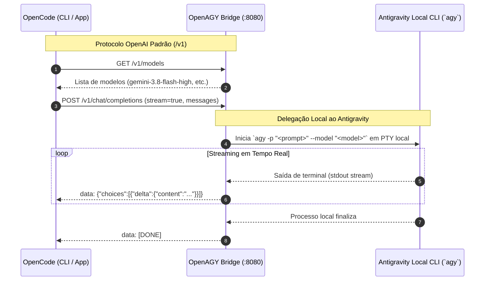

# Arquitetura do OpenAGY Bridge

## 1. Visão Geral e Princípio de Desacoplamento

O **OpenAGY** foi projetado seguindo uma premissa estrita de **isolamento mútuo**:

1. **O OpenCode não conhece o Antigravity**:
   - Conecta-se à URL local `http://127.0.0.1:8080/v1` exatamente como se estivesse conectando-se a qualquer provedor comercial compatível com OpenAI (ex.: OpenAI, Groq, Mistral, Ollama).
   - Envia requisições HTTP REST normais com `Authorization: Bearer <API_KEY>`, esperando o protocolo padrão `/v1/chat/completions` com Server-Sent Events (SSE).
   
2. **O Antigravity não conhece a ponte**:
   - O Antigravity CLI e a IDE continuam operando normalmente.
   - Para o ecossistema do Google Antigravity, as requisições geradas pela ponte são indistinguíveis das sessões iniciadas pelo usuário no terminal:
     - Utilizam a sessão OAuth autenticada em `~/.gemini/antigravity-cli/antigravity-oauth-token`.
     - Renovam automaticamente os tokens de acesso usando o `refresh_token` do usuário.
     - Comunicam-se através dos mesmos canais de SSE usados pelo binário `agy` (`cloudcode-pa.googleapis.com`).

---

## 2. Diagrama de Fluxo de Dados (Local Antigravity)

---

## 3. Componentes do Sistema

| Módulo | Arquivo | Responsabilidade |
| :--- | :--- | :--- |
| **Config** | `openagy/config.py` | Portas, endpoints do backend, caminhos dos tokens locais e variáveis de ambiente. |
| **Auth Manager** | `openagy/auth.py` | Carrega e renova tokens OAuth do Google armazenados na máquina local. |
| **Model Registry** | `openagy/models.py` | Catálogo de modelos expostos para o OpenCode e mapeamento de aliases. |
| **Adapter** | `openagy/adapter.py` | Tradutor bidirecional de mensagens, parâmetros, function calling e SSE chunks. |
| **Engine CloudCode** | `openagy/engines/cloudcode_engine.py` | Executa inferência direta no endpoint Cloud Code com SSE nativo. |
| **Engine CLI** | `openagy/engines/cli_engine.py` | Engine alternativo que dispara subprocessos do binário `agy -p`. |
| **Server** | `openagy/server.py` | Servidor FastAPI expondo as rotas `/v1/models` e `/v1/chat/completions`. |
| **Setup Helper** | `setup_opencode.py` | Injeta o provedor `openagy` no arquivo `~/.config/opencode/opencode.json`. |

---

## 4. Mapeamento de Protocolos

### A. Papéis (Roles)
| OpenAI (OpenCode) | Antigravity / Gemini |
| :--- | :--- |
| `system` | `systemInstruction.parts` |
| `user` | `contents.role = "user"` |
| `assistant` | `contents.role = "model"` |
| `tool` | `contents.role = "user"`, `functionResponse` |

### B. Tool Calling (Function Calls)
- **OpenCode envia:** `tools: [{ type: "function", function: { name, description, parameters } }]`
- **OpenAGY converte para:** `tools: [{ functionDeclarations: [ { name, description, parameters } ] }]`
- **Antigravity responde:** `parts: [{ functionCall: { name, args } }]`
- **OpenAGY devolve ao OpenCode:** `choices[0].delta.tool_calls: [{ id, function: { name, arguments } }]`
